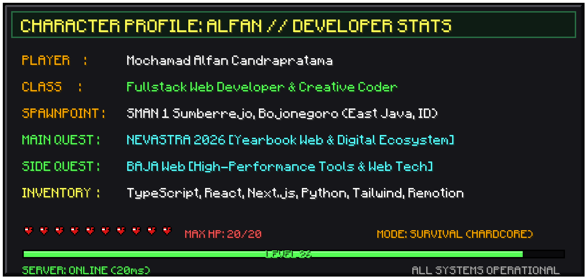

  

  

  
  
  

---

### 🎮 Character Stats & About Me

  

---

### 🛠️ Tech Stack & Inventory

  <!-- Languages -->
  
  
  
  
  
   
  <!-- Frameworks & Libs -->
  
  
  
  
  
  
   
  <!-- Tools & Workflow -->
  
  
  

---

### 📊 GitHub Activity & Stats

  
  

  

---

  

